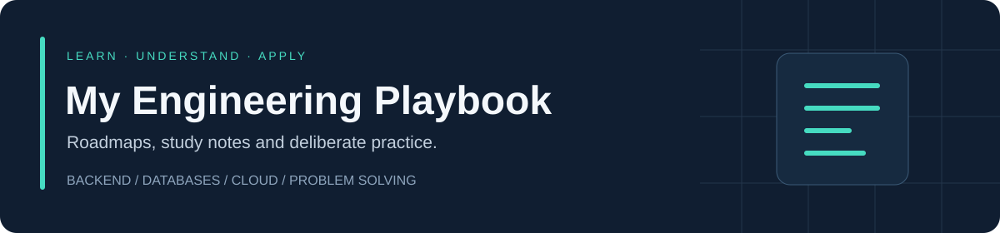

  

  <a href="roadmaps/README.md">Start learning</a> ·
  <a href="notes/README.md">Browse notes</a> ·
  <a href="practice/README.md">Practise</a> ·
  <a href="CONTRIBUTING.md">Contribute</a>

# My Engineering Playbook

A growing engineering learning reference, built from personal study and open to contributions. Follow a roadmap, understand each concept, and apply it through examples and exercises.

Written in clear English for students, working developers and anyone revisiting the fundamentals. Topics build from backend and database foundations toward cloud and broader software engineering.

## Start here

1. **Choose a track** from the [learning roadmaps](roadmaps/README.md). Each track lists prerequisites, reading order and practical checkpoints.
2. **Read the linked note** and explain the idea in your own words.
3. **Try the exercise** before looking at a solution. Record what worked and what needs another attempt.
4. **Track your own progress** using a copy of the [study tracker](templates/study-tracker.md). Roadmap statuses describe the available content, not your personal progress.

## Choose your learning track

| Track | What you will learn | Roadmap | Material available now |
| --- | --- | --- | --- |
| Backend fundamentals | Communication patterns and the foundations of reliable APIs | [Follow the track](roadmaps/backend-fundamentals.md) | One structured communication note; further topics planned |
| Database engineering | Transactions, storage, indexing and SQL reasoning | [Follow the track](roadmaps/database-engineering.md) | Five draft concept notes, SQL exercises and design scenarios |
| AWS & cloud | Cloud concepts, AWS foundations and architecture decisions | [Follow the track](roadmaps/aws-cloud.md) | Four draft notes in the existing SAA-C03 collection |
| Coding practice | String manipulation, reasoning and problem-solving habits | [Follow the track](roadmaps/coding-practice.md) | Ten beginner string exercises with Java and Python solutions |

## What a study note contains

| Section | The question it answers |
| --- | --- |
| Concept | What is it, and how does it work? |
| Why it matters | What problem does it solve? |
| Example | What does it look like in a concrete situation? |
| Trade-offs | What do we gain, and what does it cost? |
| Common mistakes | Where do people go wrong? |
| Interview questions | Can I explain and apply it without memorising? |
| References | Where can I verify the explanation and read further? |

See the [study-note template](templates/study-note.md) and the [communication patterns example](notes/backend-fundamentals/01-communication-patterns.md).

## Content status

- **Structured:** Uses all seven sections and includes references. This describes the format; it is not a guarantee that every claim has been independently reviewed.
- **Draft:** Existing material is available, but needs a format, source or technical review.
- **Planned:** Listed in a roadmap; no local study note is available yet.

This is a work in progress. Existing notes are retained as drafts so readers can see the actual coverage and help improve it.

## Find your way around

| Location | Purpose |
| --- | --- |
| [roadmaps/](roadmaps/README.md) | Reading order, prerequisites, outcomes and future topics |
| [notes/](notes/README.md) | Concept explanations organised by subject |
| [practice/](practice/README.md) | Coding problems, SQL exercises and database design prompts |
| [templates/](templates/README.md) | Reusable formats for notes, exercises and personal progress |
| [assets/](assets/README.md) | Shared diagrams and illustrations |
| [CONTRIBUTING.md](CONTRIBUTING.md) | How to add or improve learning material |

Looking for an old file? See the [path migration guide](docs/path-migration.md).

## Help this reference grow

Improve a draft, explain a trade-off, contribute a reproducible example, or pick a planned topic. Link each contribution to a roadmap and include trustworthy sources. See the [contribution guide](CONTRIBUTING.md) for the workflow and checks.

Maintained by [Hasan Mahmud Rhidoy](https://github.com/rhidoyhasanmahmud).
