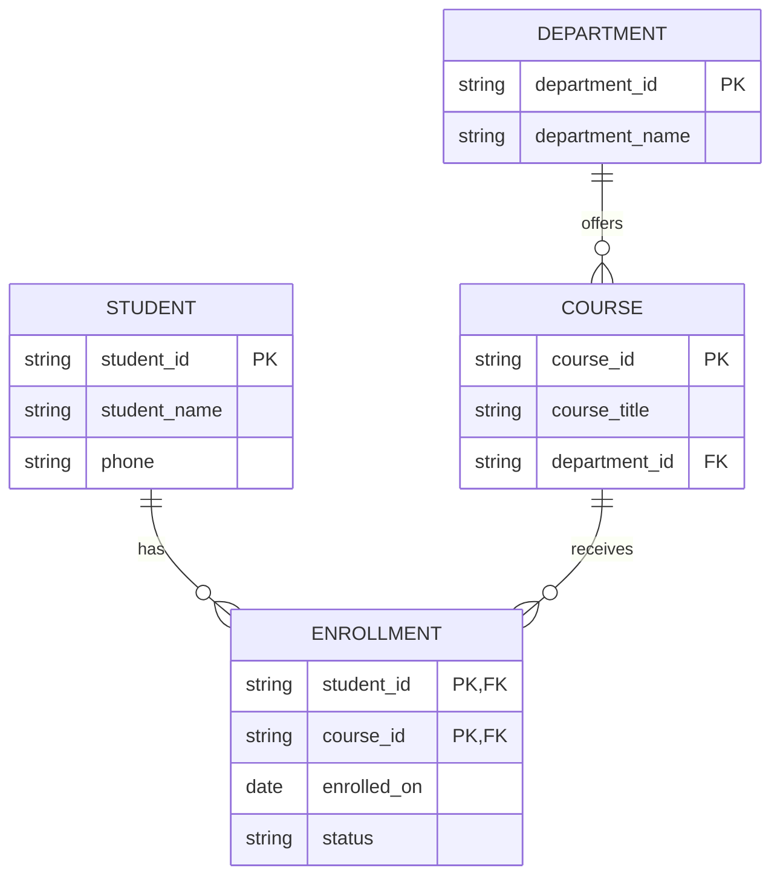

# Database foundations before SQL

[Learning roadmap](../../roadmaps/database-foundations.md) · [Database notes](README.md) · [Practice worksheet](../../practice/database-design/before-sql-capstone.md)

**Start here if:** you have used an application or a spreadsheet, but cannot yet explain how its data should be organised. No programming, database installation or SQL knowledge is required.

**Finish able to:** turn simple requirements into tables, explain their keys and relationships, prevent common data errors and improve a design through third normal form. You will then be ready to learn SQL.

This note teaches concepts using one small **Student–Course Enrollment** system. Tables and expected outcomes are illustrations, not results from an executed database. Product-specific details are labelled; PostgreSQL references use version 18.

### Reading guide

| Part | Read | You should be able to explain |
| --- | --- | --- |
| 1 | [Data and databases](#1-data-information-and-metadata), [DBMS and SQL](#2-database-dbms-rdbms-and-sql) | What is stored, and which software manages it |
| 2 | [Files and spreadsheets](#3-files-spreadsheets-and-databases), [data models](#4-common-data-models) | Why a particular storage approach fits a problem |
| 3 | [Tables and schema](#5-tables-entities-and-schema), [types and missing data](#6-data-types-domains-and-missing-values) | What one row means and what each field can contain |
| 4 | [Keys](#7-keys-and-identity), [constraints](#8-constraints-and-integrity), [relationships](#9-relationships-cardinality-and-optionality) | How records are identified, connected and protected |
| 5 | [Modelling and ER diagrams](#10-from-requirements-to-an-er-diagram), [normalization](#11-dependencies-anomalies-and-normalization) | How to turn requirements into a consistent design |
| 6 | [Operations and reliability](#12-operations-transactions-and-responsible-data-handling) | What changes data and what can go wrong |
| Apply | [Worked example](#example), [trade-offs](#trade-offs), [interview questions](#interview-questions) | How to defend the design and recognise its limits |

## Concept

### 1. Data, information and metadata

**Data** is a recorded representation of facts: a student identifier, a course title or an enrollment date. **Information** is what those facts mean in context. The value `3` alone tells us little; “three students enrolled in Database Foundations” answers a question.

**Metadata** describes the data: field names, allowed types, required values and the meaning of a table. For example, “`enrolled_on` is the date on which enrollment was accepted” is metadata. A clear definition matters because an application might also have an application date or a course start date.

A **database** is an organised collection of related data. In software systems, it is usually stored electronically and managed so that applications can retrieve and change it. A database does not have to use tables: different data models organise records differently. See [R1](#references).

**Check:** Is `S101` meaningful without knowing which system issued it and what it identifies?

### 2. Database, DBMS, RDBMS and SQL

These words refer to different things:

| Term | Meaning | Example in our learning system |
| --- | --- | --- |
| Database | The organised data collection | Students, courses, departments and enrollments |
| DBMS | Database management system: software that manages databases | Software handling storage, access, changes and permissions |
| RDBMS | A DBMS based on the relational model | PostgreSQL, which represents related data in tables |
| SQL | A language used to define, read and change data in many relational systems | The language we will study after designing the model |

An application receives a user's request and applies business behaviour. It asks the DBMS to read or change the database, then presents the result. The database is not the application interface; SQL is not the stored data or the DBMS itself.

This note uses **relational design** for its detailed examples. SQL and relational databases are closely associated, but language support alone does not define a data model. See [R1](#references) and [R2](#references).

### 3. Files, spreadsheets and databases

A CSV file or spreadsheet can be an excellent starting point for a small, manually maintained list. A DBMS becomes useful when several users or programs need coordinated access, enforceable rules, relationships, controlled permissions or recovery after failures.

Imagine two administrators downloading the same enrollment spreadsheet. One adds a student; the other corrects a course name. If the second person uploads an older copy, the first change may disappear. A DBMS provides mechanisms for coordinating updates, although the application still needs to use them correctly.

| Need | A file or spreadsheet can suit | A DBMS becomes attractive when |
| --- | --- | --- |
| Simple storage | A small export or a temporary list | Records form an ongoing application data model |
| Editing | One editor or a suitable collaboration workflow | Many independent requests change related records |
| Rules | Manual checking is acceptable | Rules must also apply to imports and background jobs |
| Recovery | Versioned files meet the recovery need | Consistent recovery of a running application is required |

Databases add modelling, operational and learning costs. They are not automatically faster for every task. Also, many DBMSs store data in files internally; the important difference is how those files are managed. [R1](#references) provides an overview of DBMS responsibilities.

### 4. Common data models

| Model | Organises data as | Useful question to ask |
| --- | --- | --- |
| Relational | Tables with defined attributes and relationships | Which facts belong together, and which rules connect them? |
| Document | Documents with fields, possibly nested objects or lists | Which data is commonly read and changed together? |
| Key–value | Values addressed by a key | Can most requests identify the required value by its key? |
| Graph | Nodes, relationships and their properties | Are traversals across relationships central to the problem? |

These are modelling options, not a ranking. A document database can have validation rules; “NoSQL” does not mean “no structure” or “no transactions.” MongoDB documents embedding, references, schema validation and transaction support [R3](#references). Neo4j documents the property graph model [R4](#references).

Keep these other classifications separate:

- **Row-oriented and column-oriented storage** concern how data is physically organised. They are not the same distinction as relational versus document.
- **Wide-column databases** and analytical column-oriented storage are different concepts, despite similar names.
- **Cloud, embedded and distributed** describe deployment or architecture, not a single data model.
- **OLTP** workloads emphasise operational transactions; **OLAP** workloads emphasise analytical questions across data. A product may support both to different degrees.

For now, learn to justify a relational model for enrollment records. Product selection and storage internals come later.

### 5. Tables, entities and schema

An **entity** is something we need to represent, such as a student. An **attribute** describes it, such as a name. In our relational design, a table stores records about an entity type or an association, a row represents one record, and a column represents an attribute.

The most useful question before naming columns is: **What does one row represent?** This is sometimes called the table's grain.

| Table | One row represents |
| --- | --- |
| Student | One student registered in the system |
| Department | One department responsible for courses |
| Course | One course in the catalogue |
| Enrollment | One student's enrollment in one course |

A **schema**, in the general design sense, describes structure and rules. A **data instance** is the collection of values stored at a particular moment. Adding a student changes the instance; adding a new attribute changes the schema.

In PostgreSQL, “schema” also names a namespace inside a database. That product feature is related terminology, not a replacement for the general meaning above [R5](#references).

A displayed row number is not a reliable identifier. Stored rows have no guaranteed presentation order; requesting a particular order is a later SQL lesson [R2](#references).

### 6. Data types, domains and missing values

A **data type** describes the kind of value a field can store. A **domain** is its intended set of valid values; this can be narrower than the type alone.

| Attribute | Conceptual type | Domain or interpretation |
| --- | --- | --- |
| `student_id` | Text identifier | Assigned by this system; required and unique |
| `phone` | Optional text | Preserve a leading `+` or zero; do not calculate with it |
| `capacity` | Integer | A whole number greater than or equal to zero |
| `fee_amount` | Exact decimal | Non-negative amount with an explicit currency elsewhere |
| `enrolled_on` | Date | Calendar date enrollment was accepted |
| `status` | Restricted text | One of `active`, `completed`, `cancelled` |

Do not choose a numeric type merely because an identifier contains digits. Choose meaning first. For monetary amounts, define currency, precision and rounding rules; an exact decimal type avoids the binary approximation associated with floating-point types, but does not decide business rounding for you [R6](#references).

A date is not the same as a timestamp. If the business must record an exact event time across locations, define the time-zone interpretation. We only need calendar dates in the worked example.

**NULL** marks a missing value in SQL databases. It is not zero, an empty string or the text `"NULL"`. For an optional phone field it might mean “not provided.” Document the meaning: “unknown,” “not collected” and “not applicable” can require separate representation when that distinction matters.

Do not reason about missing values as ordinary comparable values. In PostgreSQL, ordinary comparisons involving NULL produce an unknown result. The syntax and filtering consequences belong in the SQL track [R7](#references).

### 7. Keys and identity

A key identifies a row according to rules that must hold for **all valid data**, not just today's sample. Two students can have the same name; two different names in a small sample do not prove that names are unique.

| Key term | Meaning | Example under our stated rules |
| --- | --- | --- |
| Superkey | A set of attributes sufficient to identify a row uniquely | In Student, `{student_id, name}` |
| Candidate key | A superkey with no unnecessary attribute: removing any attribute loses the guarantee | `{student_id}` |
| Primary key | The candidate key chosen as the main identifier | Student's `student_id` |
| Alternate key | A candidate key not chosen as the primary key | A required, unique institutional email, **if that rule is adopted** |
| Composite key | A key made from more than one attribute | Enrollment's `{student_id, course_id}` |
| Natural key | An identifier with meaning in the business domain | An institution-issued registration number |
| Surrogate key | An identifier introduced for record identity | An internally generated student identifier |
| Foreign key | Attributes constrained to refer to an eligible key in another, or the same, table | Enrollment's `student_id` refers to Student |

“Minimal” means no attribute can be removed while retaining uniqueness; it does not mean the shortest text or necessarily the smallest candidate key by attribute count. A composite key is one key with several parts.

The alternate-email example is conditional. Our worked model does not store email. A sample address being different today is not enough to justify a uniqueness rule tomorrow.

A surrogate primary key does not automatically enforce business uniqueness. If Enrollment used a generated `enrollment_id`, we would still need to protect the unique student–course pair under our current rule. Introductory key definitions are available in [R8](#references).

### 8. Constraints and integrity

Constraints state which stored values and relationships are permitted. They help keep data valid even when several applications, scripts or imports write to it.

| Rule | Purpose | Example |
| --- | --- | --- |
| Primary key | Identify each row; values must be unique and not missing | Two students cannot share `student_id` |
| Required value | Prevent absence where the model needs a value | Every course needs a title |
| Uniqueness | Protect a distinct value or combination | A student cannot enroll in the same course twice in this model |
| Allowed-value/range rule | Restrict a field's domain | Status is one of three agreed values |
| Foreign key | Protect a reference to an existing record | An enrollment cannot refer to a nonexistent student |

Referential integrity is about valid references. A foreign key need not point only to a primary key; eligible unique keys can also be targets. Supported details depend on the DBMS [R9](#references).

Specify requiredness separately from uniqueness or a range rule. NULL handling in uniqueness constraints varies across systems. A **default** supplies a value when one is omitted; it does not by itself reject invalid alternatives.

Define what happens when a referenced record is deleted. For our model, reject deletion of a student with enrollments until those records are handled explicitly. Automatically deleting dependent records is another possible policy, but must match retention requirements.

Constraints cannot establish every real-world truth. A valid student ID does not prove that the student consented to enroll. Some rules need application behaviour, transactions or additional database mechanisms. Document who enforces each rule rather than assuming one layer handles everything.

### 9. Relationships, cardinality and optionality

**Cardinality** describes how many records may participate in a relationship. **Optionality** describes whether participation is required. State both ends; “one-to-many” alone leaves important questions unanswered.

| Relationship | Business rule | Typical relational representation |
| --- | --- | --- |
| One-to-one | One student has at most one profile; each profile belongs to one student | A foreign key on Profile plus uniqueness; require the reference for every profile |
| One-to-many | One department has zero or many courses; each course belongs to exactly one department | A required department reference on Course |
| Many-to-many | One student can take many courses; one course can have many students | An Enrollment association table with both references |

If Profile must exist for every Student, that is an additional mandatory-participation rule; the Profile foreign key alone does not enforce it.

An **association table**, also called a junction table, stores a relationship as rows. It can hold attributes of the relationship. Enrollment's `status` describes one student taking one course, so it belongs to Enrollment rather than Student or Course.

Avoid fields such as `course_1`, `course_2` and `course_3`. They impose an arbitrary limit and make each new course require a new field. Relationship concepts and ER notation are discussed in [R10](#references).

### 10. From requirements to an ER diagram

Work through three levels [R11](#references):

1. **Conceptual model:** identify important things, relationships and business rules in plain language.
2. **Logical model:** define tables, attributes, keys, domains and cardinalities, without committing to engine syntax.
3. **Physical design:** choose engine-specific types, indexes, storage and implementation details.

This note concentrates on the first two. An **entity–relationship (ER) diagram** makes entities and their connections visible. It supports a written specification; it does not describe every validation rule by itself.

Ask about ambiguous cases before drawing: Can a course exist before enrollment opens? Can a student retake a course? Can two departments jointly own a course? A different answer can change the model. The [worked diagram](#worked-er-diagram) follows explicit, simplified answers.

### 11. Dependencies, anomalies and normalization

A **functional dependency** means one set of attributes determines another under the business rules. We write `student_id → student_name`: whenever two valid records have the same student ID, they must agree on its current stored name. The arrow does not mean the name identifies the student or can never change.

Repeating the same fact across unrelated records can create **anomalies**:

- **Update anomaly:** a department name is changed in some enrollment rows but not others.
- **Insertion anomaly:** a new course cannot be recorded because the only table requires a student enrollment.
- **Deletion anomaly:** removing the last enrollment accidentally removes the only stored information about a course.

**Normalization** uses dependencies to organise relations and reduce these problems. It does not mean “remove every repeated value.” Foreign keys repeat intentionally to represent relationships.

| Normal form | Beginner working rule | What to inspect |
| --- | --- | --- |
| First normal form (1NF) | Use one value from the chosen domain per attribute; avoid repeating groups or packed lists of independent facts | A list of course IDs inside one enrollment field |
| Second normal form (2NF) | Be in 1NF; every non-prime attribute must depend on each whole candidate key, not a proper subset | Student name depends on only the student part of an enrollment key |
| Third normal form (3NF) | Be in 2NF; in our simple examples, move non-key facts that depend on other non-key facts to their own relation | Department name is determined by department ID inside Course |

A **non-prime attribute** belongs to no candidate key. Evaluate dependencies against all candidate keys, not only the selected primary key. Adding a single-column surrogate primary key does not automatically repair a poorly structured table.

“Atomic” in 1NF depends on the domain and the intended operations: a date can be one value even though people can describe its year, month and day. Here, a list of unrelated course IDs should become enrollment rows because each course participates independently in a relationship.

Optional precision: the general 3NF definition

For every nontrivial dependency `X → A`, either `X` is a superkey or `A` belongs to some candidate key. “Nontrivial” means `A` is not already part of `X`. The simpler rule in the table explains our example; it is not the full definition for overlapping candidate keys. You can complete the worked example before revisiting this formal wording.

Splitting tables must preserve the original facts and their associations. Arbitrarily splitting columns without retaining the right keys can lose information or invent combinations. Formal decomposition proofs, BCNF and higher normal forms are later topics. [R8](#references) introduces dependencies and normalization; [R12](#references) gives another practical introduction.

### 12. Operations, transactions and responsible data handling

**CRUD** names four broad operations: create a record, read it, update it or delete it. These are actions on data, not four kinds of table. We will learn their SQL expressions later.

A **transaction** groups operations into a unit of work. Suppose accepting an enrollment also reserves one available seat. If only one change is saved, the system can contradict itself. The intended outcome is that both changes succeed together or neither takes effect.

The ACID vocabulary is useful at awareness level:

| Property | Core idea |
| --- | --- |
| Atomicity | The transaction's changes take effect together or are rolled back |
| Consistency | A correctly designed transaction preserves the defined invariants |
| Isolation | Concurrent transactions interact under the guarantees of the selected isolation level |
| Durability | A committed result survives the failures covered by the system's durability guarantees |

An invariant is a rule that must remain true, such as “reserved seats cannot exceed capacity.” ACID does not invent missing business rules. Isolation is not a promise that every default configuration behaves like serial execution. If two requests both see one remaining seat, checking availability separately from reserving it is insufficient. The SQL and transaction stages will teach the mechanisms [R13](#references).

Finally, collect only necessary data, grant appropriate permissions, keep credentials out of notes and plan recovery. A backup is useful only if the required data can actually be restored; transactions and replication do not replace a suitable backup strategy. Permission and backup details are operational topics [R14](#references), [R15](#references).

## Why it matters

| Foundation | Failure it helps prevent |
| --- | --- |
| Clear row meaning | Mixing a student, a course and a particular enrollment in one ambiguous record |
| Stable identity | Editing the wrong student because two students share a name |
| Keys and constraints | Duplicate enrollment and references to missing courses |
| Relationships | Adding new columns whenever a student takes another course |
| Normalization | Updating the same department fact inconsistently in several places |
| Transaction awareness | Promising the same last seat to two people |
| Explicit assumptions | Discovering too late that the model cannot represent retakes |

You can memorise SQL syntax and still build an unreliable model. These foundations help you decide **what the data means** before deciding how to query it. For a one-off list, a spreadsheet may remain sufficient; the design questions become more valuable as shared data and business rules grow.

## Example

### Business rules for the running example

This is an original, simplified course catalogue. It does not model terms, course offerings, grades, payment or retakes.

1. Every student, course and department has a stable identifier. Names and titles need not be unique.
2. Each course belongs to exactly one department. A department can exist without courses.
3. A student can enroll in many courses; a course can have many students. Either can exist with no enrollments.
4. A student can have at most one enrollment record per course, even after cancellation. Retaking a course would require a revised model.
5. Each enrollment records an acceptance date and a status: `active`, `completed` or `cancelled`.
6. Names, titles, references, enrollment dates and statuses are required. Phone is optional.
7. Reject deletion of a student or course referenced by Enrollment, and of a department referenced by Course, until dependents are handled explicitly.

`S101`, `C101` and `D10` are illustrative identifiers assigned by this system. Their prefixes aid reading; no business meaning or ordering should be inferred from them.

### Sample records and data dictionary

**Student — primary key: `student_id`**

| student_id | student_name | phone |
| --- | --- | --- |
| S101 | Amina | NULL |
| S102 | Rafi | NULL |
| S103 | Amina | NULL |

**Department — primary key: `department_id`**

| department_id | department_name |
| --- | --- |
| D10 | Computing |
| D20 | Business |

**Course — primary key: `course_id`; required foreign key: `department_id`**

| course_id | course_title | department_id |
| --- | --- | --- |
| C101 | Database Foundations | D10 |
| C102 | Backend Basics | D10 |
| C201 | Business Basics | D20 |

**Enrollment — composite primary key: `(student_id, course_id)`; both fields are also foreign keys**

| student_id | course_id | enrolled_on | status |
| --- | --- | --- | --- |
| S101 | C101 | 2026-10-01 | active |
| S101 | C102 | 2026-10-02 | active |
| S102 | C101 | 2026-10-03 | completed |

In these illustrations, `NULL` denotes absence, not a four-character string.

The dictionary is part of the design, not just a list of field names:

| Field group | Meaning and rule |
| --- | --- |
| Entity IDs | Text identifiers; required, stable and unique within their own entity table |
| Names and title | Required text; nonblank under application validation; not identity keys |
| Student phone | Optional contact text; missing means no phone value was supplied |
| Course department | Required reference to an existing Department |
| Enrollment student and course | Required references; the pair is unique |
| Enrollment date | Required calendar date accepted, not the course start date |
| Enrollment status | Required member of the three allowed values; valid status transitions are a separate rule |

### Worked ER diagram

The labels `string` and `date` are conceptual types, not executable database declarations. The two PK markers on Enrollment form **one composite key**.

Read `||` as exactly one and `o{` as zero or many. The diagram says:

- Each Course references exactly one Department; each Department has zero or many Courses.
- Each Enrollment references exactly one Student and one Course.
- Each Student and each Course can participate in zero or many Enrollments.

S103 and C201 have no enrollments and remain valid records. We do not add an empty Enrollment row for them.

### Normalization walkthrough

Start with a poorly designed student list:

| student_id | student_name | course_ids |
| --- | --- | --- |
| S101 | Amina | C101, C102 |
| S102 | Rafi | C101 |

The packed course list makes it awkward to attach a separate date and status to each enrollment. Create one row per student–course relationship. If we also copy descriptive information into those rows, the resulting flat table looks like this:

| student_id | course_id | student_name | course_title | department_id | department_name | enrolled_on | status |
| --- | --- | --- | --- | --- | --- | --- | --- |
| S101 | C101 | Amina | Database Foundations | D10 | Computing | 2026-10-01 | active |
| S101 | C102 | Amina | Backend Basics | D10 | Computing | 2026-10-02 | active |
| S102 | C101 | Rafi | Database Foundations | D10 | Computing | 2026-10-03 | completed |

**1NF:** Independent enrollments are rows with single values in their attributes. The pair `(student_id, course_id)` is the candidate key under our no-retakes rule. Being in 1NF has not removed repeated student and course facts.

**Dependencies come from the requirements**, not from noticing equal values in this tiny sample:

| Determinant | Determines |
| --- | --- |
| `student_id` | `student_name` |
| `course_id` | `course_title`, `department_id` |
| `department_id` | `department_name` |
| `(student_id, course_id)` | `enrolled_on`, `status` |

**2NF:** Move facts that depend on only part of the enrollment key:

- Student contains `student_id`, `student_name` and the separately collected optional phone.
- Course temporarily contains `course_id`, `course_title`, `department_id`, `department_name`.
- Enrollment retains `student_id`, `course_id`, `enrolled_on`, `status`.

Now changing Amina's name affects her Student record, not each enrollment. The IDs in Enrollment preserve which student took which course.

**3NF:** In the temporary Course table, `course_id → department_id → department_name`. Department name describes a department. Move `department_id` and `department_name` into Department and keep the department reference in Course. This produces the four tables shown above.

The result allows a course or student to be stored before any enrollment exists. However, normalization cannot recover absent facts: S103, C201 and D20 must be added from their own source records; they cannot be inferred from the three flat enrollment rows.

To check that we preserved the original enrollment facts, follow each Enrollment's student and course references, then the course's department reference. Each of the original three flat rows can be reconstructed with the same names, titles, dates and statuses. Removing Enrollment or omitting either reference would lose the association.

### Predict changes before learning SQL

These are expected outcomes under the declared rules, evaluated independently against the sample:

| Proposed change | Expected outcome | Reason |
| --- | --- | --- |
| Add student S104, also named Amina | Accept | Names need not be unique |
| Add another student with ID S101 | Reject | Duplicate primary key |
| Enroll S103 in C201 with a date and `active` status | Accept | Both references exist and the pair is new |
| Enroll S999 in C101 | Reject | S999 does not exist |
| Add a second enrollment for S101 and C101 | Reject | Duplicate composite key |
| Assign status `waiting` to an enrollment | Reject | Outside the allowed domain |
| Rename D10 to Computing and Data | Accept | One department fact changes; course references remain valid |
| Delete C101 while its enrollments remain | Reject under our policy | Enrollment still references C101 |
| Delete S103 | Accept under the listed rules | S103 currently has no dependents |

Try the [SQL-free capstone](../../practice/database-design/before-sql-capstone.md) before reading its answer guide. It transfers the same reasoning to a library-loan model, so you must make decisions rather than copy this diagram.

## Trade-offs

| Choice | Benefit | Cost or limitation | Decision for this example |
| --- | --- | --- | --- |
| Spreadsheet or file | Easy to inspect and share for a small task | Coordinated updates and rules require an appropriate workflow | Useful for initial requirements and exports |
| Relational DBMS | Explicit relationships, constraints and transaction mechanisms | Requires design, implementation and operations | Fits the shared enrollment model |
| Natural identifier | Can match an existing business identifier | Business identifiers may change or have awkward scope | Confirm stability before choosing one |
| Surrogate identifier | Separates internal identity from mutable descriptions | Does not enforce independent business uniqueness | Use stable IDs for our entities |
| Composite enrollment key | Directly enforces the no-duplicate-pair rule | References to an enrollment need both parts | Suitable for the simplified no-retakes rule |
| Normalized tables | Keep each descriptive fact in its appropriate place | Reading a combined view requires following relationships | Start with the four-table design |
| Deliberate duplication | Can support a measured read need or preserve a historical snapshot | Requires a clear owner and consistency/history policy | Do not add without a specific requirement |
| Optional fields | Represent genuinely absent values | Readers and rules must handle missingness consistently | Allow absent phone, require enrollment references |

Normalization is not a guarantee of faster queries. Neither is duplication a guarantee of better performance. Measure a real workload later. Also, a historical fact can be different from a duplicated current fact: the amount charged when enrolling is not necessarily today's advertised fee.

## Common mistakes

1. **Treating SQL as the database.** Separate the stored collection, the managing software and the language used to interact with it.
2. **Choosing fields before defining a row.** Write “one row represents…” first; separate student identity from enrollment state.
3. **Using names or displayed row positions as identity.** Names can repeat and ordering can change. Define a stable key.
4. **Inferring uniqueness from sample data.** Ask for the business rule and test future cases, including duplicates and missing values.
5. **Storing phone numbers as quantities.** Preserve their textual meaning, formatting and leading characters.
6. **Replacing every missing value with zero or empty text.** This destroys distinctions. Define what absence means for each optional field.
7. **Assuming a foreign key makes a relationship one-to-one.** Multiple referencing rows are normally possible; a uniqueness rule is also needed for at-most-one.
8. **Assuming a foreign key makes both ends mandatory.** A required child reference does not require every parent to have a child.
9. **Adding an ID and calling the model normalized.** Dependencies and business uniqueness still need review.
10. **Putting relationship attributes on an entity.** Enrollment status varies by student–course pair, not by student alone.
11. **Deleting dependents automatically without deciding policy.** Define what should happen and whether history must remain.
12. **Calling NoSQL schema-free or nontransactional by definition.** Check the particular product and configuration.
13. **Assuming a valid status value implies a valid transition.** An allowed `completed` value does not establish whether a cancelled enrollment may become completed.
14. **Assuming the teaching model supports every real course system.** Terms, retakes and shared course ownership change the requirements.

## Interview questions

Answer aloud first; then compare your reasoning with the short guide.

| # | Question | Answer guide |
| --- | --- | --- |
| 1 | How do database, DBMS and SQL differ? | Collection, managing software and interaction language respectively. |
| 2 | When would you keep a spreadsheet? | A small task with an adequate editing, validation and recovery workflow; justify the requirements. |
| 3 | What does one Enrollment row mean? | One student's single enrollment record in one course, under the no-retakes assumption. |
| 4 | Does changing a student's name change the schema? | No; it changes stored values. Adding a new attribute changes the schema. |
| 5 | Can two candidate keys have different numbers of attributes? | Yes. Each is minimal by removal, not necessarily equal in size. |
| 6 | Why is student name not a candidate key? | Our rules permit different students with the same name. |
| 7 | Why is the enrollment key composite? | Neither student nor course alone identifies an enrollment; their pair does under the stated rule. |
| 8 | If Enrollment gets a generated ID, what other rule remains? | The student–course pair must still be unique under this model. |
| 9 | Must every foreign key reference a primary key? | No; supported eligible unique keys can also be targets. Check the DBMS. |
| 10 | How would you model an optional one-to-one profile? | Profile references Student, requires that reference and makes it unique; Student may have no profile. |
| 11 | Where should enrollment status live? | On the association, because it describes a particular student taking a particular course. |
| 12 | Is NULL the same as an empty string? | No. Define the absence meaning and verify engine-specific behaviour. |
| 13 | Give one update, insertion and deletion anomaly. | Repeated department names diverge; a course needs a fake enrollment; deleting the last enrollment loses course facts. |
| 14 | What changes from 1NF to 2NF here? | Move student and course facts off the composite-key enrollment relation because they depend on only part of its key. |
| 15 | Why extract Department for 3NF? | Department name depends on department ID; store that fact with the department. |
| 16 | Should all repeated values be removed? | No. Repeated foreign keys represent valid relationships. |
| 17 | Can normalization invent students absent from the input? | No. New facts need their own source records. |
| 18 | Why is a separate availability check unsafe for the last seat? | Concurrent requests can observe the same availability; the invariant needs coordinated enforcement. |
| 19 | Do transactions make backups unnecessary? | No. They address different failure and recovery concerns. |
| 20 | What changes if a student can retake a course? | Revisit enrollment identity, usually introducing a course offering or attempt model and its uniqueness rules. |

## References

Primary documentation and introductory textbooks are sufficient for this foundation; no research-paper claims or benchmark results are needed. Web references were checked on **21 October 2026**. Product documentation may include SQL syntax that you can defer until the next stage.

- **R1 — IBM.** *What is a database?* IBM Think, undated. [Official overview](https://www.ibm.com/think/topics/database). Database, DBMS and data-model vocabulary; use it as an overview rather than a product-selection benchmark.
- **R2 — PostgreSQL Global Development Group.** *PostgreSQL 18 Documentation, §2.2: Concepts.* [Official documentation](https://www.postgresql.org/docs/18/tutorial-concepts.html). Relational tables, typed columns and the absence of an inherent row order.
- **R3 — MongoDB, Inc.** *MongoDB Manual: Data Modeling in MongoDB; Transactions.* Continuously maintained. [Data modelling](https://www.mongodb.com/docs/manual/data-modeling/) and [transactions](https://www.mongodb.com/docs/manual/core/transactions/). Document modelling, embedding, references, validation and transaction support; demonstrates that flexible schemas still require design.
- **R4 — Neo4j.** *Getting Started: What is a graph database?* Continuously maintained. [Official documentation](https://neo4j.com/docs/getting-started/graph-database/). Nodes, relationships and properties in the property graph model.
- **R5 — PostgreSQL Global Development Group.** *PostgreSQL 18 Documentation, §5.10: Schemas.* [Official documentation](https://www.postgresql.org/docs/18/ddl-schemas.html). The PostgreSQL-specific namespace meaning of schema.
- **R6 — PostgreSQL Global Development Group.** *PostgreSQL 18 Documentation, §8.1: Numeric Types.* [Official documentation](https://www.postgresql.org/docs/18/datatype-numeric.html). Exact decimal and inexact floating-point representations; engine-specific precision details.
- **R7 — PostgreSQL Global Development Group.** *PostgreSQL 18 Documentation, §9.2: Comparison Functions and Operators.* [Official documentation](https://www.postgresql.org/docs/18/functions-comparison.html). Missing-value comparison behaviour; defer the SQL syntax.
- **R8 — Adrienne Watt and Nelson Eng. (2014).** *Database Design – 2nd Edition.* Textbook, Victoria, BC: BCcampus. [Official publisher edition and citation details](https://opentextbc.ca/dbdesign01/); [Chapter 12: Normalization](https://opentextbc.ca/dbdesign01/chapter/chapter-12-normalization/). Introductory entities, keys, dependencies and normalization. The book uses simplified primary-key explanations in places; this note explicitly distinguishes primary keys from all candidate keys. Published under CC BY 4.0.
- **R9 — PostgreSQL Global Development Group.** *PostgreSQL 18 Documentation, §5.5: Constraints.* [Official documentation](https://www.postgresql.org/docs/18/ddl-constraints.html). Required values, uniqueness, primary and foreign keys, and referential actions. NULL details must be checked for the target engine.
- **R10 — Ivan Belcic and Cole Stryker.** *What is an entity relationship diagram (ERD)?* IBM Think, undated. [Official overview](https://www.ibm.com/think/topics/entity-relationship-diagram). Entities, relationships, cardinality and diagram vocabulary.
- **R11 — IBM.** *What is data modeling?* IBM Think, undated. [Official overview](https://www.ibm.com/think/topics/data-modeling). Conceptual, logical and physical modelling levels.
- **R12 — Microsoft.** *Description of the database normalization basics.* Microsoft Learn, Access support documentation. [Official documentation](https://learn.microsoft.com/en-us/previous-versions/troubleshoot/microsoft-365/microsoft-365-apps/access/database-normalization-description). A practical introduction to removing repeated groups and inappropriate dependencies; not a complete formal treatment of all normal forms.
- **R13 — PostgreSQL Global Development Group.** *PostgreSQL 18 Documentation, §3.4: Transactions.* [Official documentation](https://www.postgresql.org/docs/18/tutorial-transactions.html). Grouped changes, commit and rollback; deeper isolation behaviour belongs in the transaction track.
- **R14 — PostgreSQL Global Development Group.** *PostgreSQL 18 Documentation, §5.8: Privileges.* [Official documentation](https://www.postgresql.org/docs/18/ddl-priv.html). Database access permissions and their scope.
- **R15 — PostgreSQL Global Development Group.** *PostgreSQL 18 Documentation, Chapter 25: Backup and Restore.* [Official documentation](https://www.postgresql.org/docs/18/backup.html). Backup and recovery methods, to study when moving from design to operation.

**Next:** complete the [readiness checklist](../../roadmaps/database-foundations.md#ready-to-start-sql), then move to the [SQL stage of the database engineering roadmap](../../roadmaps/database-engineering.md). Installation, query syntax, joins, indexes and detailed transaction behaviour are later lessons.
