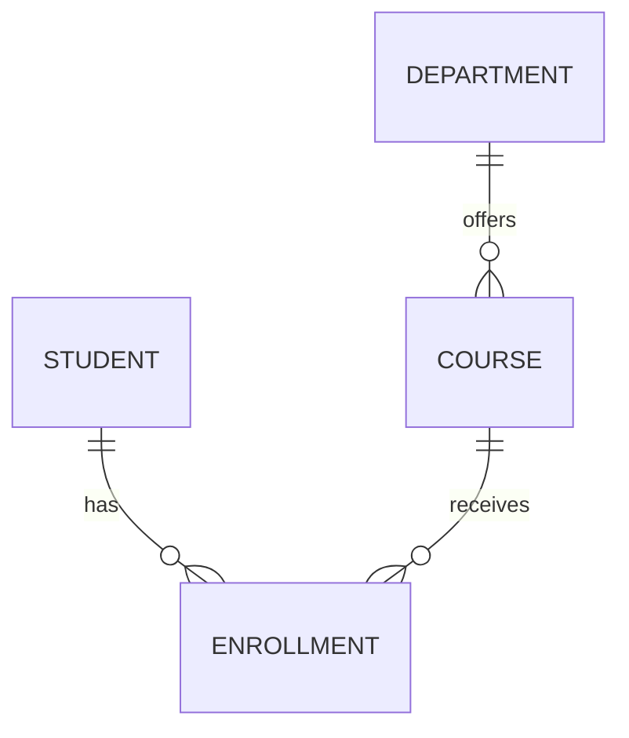

# Lesson 8: Draw your first model

Lesson **8 of 10** · [Previous](07-constraints.md) · [Course home](README.md)

**Your goal:** turn written rules into a small diagram you can explain.

## Concept

An **entity–relationship diagram**, or **ER diagram**, shows the things we store and how they connect. Start with written rules; the picture should express those rules.

We already have Student, Course and Enrollment. Add one requirement: **each course belongs to exactly one department**. A department can offer several courses, or none yet.

Create Department with a `department_id` and `department_name`. Put the department reference on Course. This is a **one-to-many relationship**: one department can have many courses, while each course belongs to one department.

Always ask both “how many?” and “is zero allowed?” Our system allows students and courses to exist before an enrollment connects them.

## Why it matters

A diagram makes the model easier to discuss. Another person can check whether our connections match the real requirements before we write database commands.

## Example

D10 is the Computing department. C101 and C102 both belong to D10.

| Table | One row represents | Main fields |
| --- | --- | --- |
| Student | One student | `student_id`, `student_name`, optional `phone` |
| Department | One department | `department_id`, `department_name` |
| Course | One catalogue course | `course_id`, `course_title`, `department_id` |
| Enrollment | One student taking one course | `student_id`, `course_id`, `enrolled_on`, `status` |

The IDs and all fields except phone are required. Names and titles need not be unique. The enrollment pair is unique under our rule that a student has only one enrollment record per course. Courses, students and departments may exist without dependents.

The `||` end means **exactly one**; the `o{` end means **zero or many**. Read one connection at a time:

- Each Course belongs to exactly one Department; a Department may have zero or many Courses.
- Each Enrollment belongs to exactly one Student and exactly one Course.
- A Student or Course may have zero or many Enrollments.

### Try it

Cover the diagram and redraw it from the rules. Where should a new course's department reference go? Does a department need a fake Course row before its first real course exists?

Check your answer

Put `department_id` on Course, referring to Department. A department can exist with zero courses, so no fake Course row is needed. Compare your three connections with the diagram.

**Ready to move on when:** you can explain each connection in both directions, including when zero records are allowed.

Extra reading — open when you want more detail

## Trade-offs

A compact diagram is easy to read, but it does not express every rule. Keep the allowed enrollment statuses and deletion policies in writing alongside it.

## Common mistakes

- Drawing lines before deciding the business rules.
- Assuming every parent record must already have a child record.
- Expecting a diagram to enforce the constraints itself.

## Interview questions

**What would change if two departments jointly owned a course?** The current one-department reference would no longer describe the requirement. We would reconsider the relationship and likely introduce an association table, just as we did for enrollment.

## References

Ivan Belcic and Cole Stryker, *What is an entity relationship diagram (ERD)?*, IBM Think, undated. [Official overview](https://www.ibm.com/think/topics/entity-relationship-diagram). Entities, relationships and cardinality; checked 21 October 2026.

[← Previous](07-constraints.md) · **[Next lesson: Keep each fact in the right place →](09-normalization.md)**
