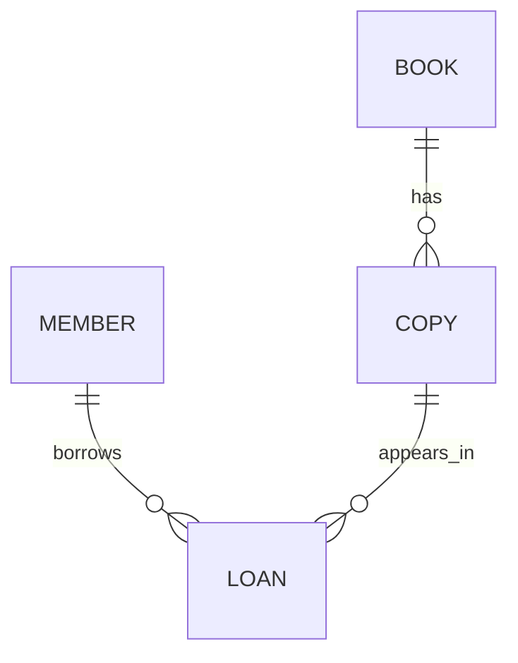

# Before-SQL capstone: library loans

[Foundation roadmap](../../roadmaps/database-foundations.md) · [Concept note](../../notes/database-engineering/00-before-sql.md) · [Design practice](README.md)

An original, SQL-free exercise. Use paper, Markdown tables or a diagram tool. The expected results follow from the stated rules; no database code has been executed.

## Problem

A small library needs to track members, book titles, physical copies and loans. Design a model that keeps loan history without repeating member and book details in every loan.

Deliver a data dictionary, keys, an ER diagram, a normalization explanation, sample records and the outcomes of the proposed changes below. Explain your decisions before opening the answer guide.

## Assumptions and examples

1. A Member has a stable `member_id` and a required name. Names can repeat. A member may have no loans.
2. A Book record represents one catalogue edition, with a stable `book_id` and required title. Different books can share a title. Authors and ISBN management are outside this exercise.
3. A physical Copy has a stable `copy_id` and belongs to exactly one Book. A Book may initially have no copies.
4. A Loan records one occasion on which a Member borrows a Copy. The same member may borrow the same copy again on a later occasion. Each loan has a stable `loan_id`.
5. Each loan has required `borrowed_on` and `due_on` dates, plus an optional `returned_on` date. Due and return dates cannot be earlier than the borrowing date. Returning late is allowed.
6. An absent return date means the loan remains open. A Copy may have at most one open Loan at a time, but many historical loans.
7. Reject deletion of a Member or Copy referenced by a Loan, and of a Book referenced by a Copy. Historical loans remain stored.
8. This simplified exercise records calendar dates, not times of day. All identifiers below are invented examples.

The library currently has M01 (Amina) and M02 (Rafi). B01 is the catalogue entry *Learning Databases*, with physical copies CP01 and CP02. It also has B02, *Backend Notes*, with no copies yet.

| loan_id | member_id | copy_id | borrowed_on | due_on | returned_on |
| --- | --- | --- | --- | --- | --- |
| L01 | M01 | CP01 | 2026-10-01 | 2026-10-10 | 2026-10-08 |
| L02 | M02 | CP01 | 2026-10-09 | 2026-10-18 | NULL |

Here, `NULL` means absent, not literal text. Evaluate each proposed change independently against this dataset:

| Case | Proposed change |
| --- | --- |
| A | Add M03, also named Amina |
| B | Add another Member with ID M01 |
| C | Open L03 for M01 and CP02 on 2026-10-10, due 2026-10-20 |
| D | Open L04 for M01 and CP01 on 2026-10-10, due 2026-10-20 |
| E | Add a Loan referencing nonexistent member M99 |
| F | Change L02's due date to 2026-10-05 |
| G | Record L02's return on 2026-10-20 |
| H | Delete CP01 while its loan history remains |
| I | Rename B01 to *Database Learning Notes* |

## Try it first

1. Write the meaning of one row for each proposed table. Distinguish a book title from a physical copy.
2. Choose conceptual field types, required values and keys. Explain why `(member_id, copy_id)` is not a valid unique loan identifier here.
3. Draw the cardinality and optionality at both ends of each relationship.
4. Start from a flat loan table containing all fields below. Identify dependencies and explain its update, insertion and deletion anomalies.

   | Loan fields | Repeated descriptive fields |
   | --- | --- |
   | `loan_id`, `member_id`, `copy_id`, `borrowed_on`, `due_on`, `returned_on` | `member_name`, `book_id`, `book_title` |

5. Separate the facts into appropriate tables. Preserve the references needed to reconstruct the original loan details.
6. Write each table's valid sample rows, including CP02 and B02, which have no loans.
7. Predict cases A–I. State which are ordinary key/reference/domain checks and which need a more specific concurrency-safe rule.
8. Explain what should happen if two librarians try to lend CP02 simultaneously.
9. Change the requirement: one member can have at most three open loans. Identify what must be checked and why a separate count followed by an uncoordinated write is insufficient.

## Solution and reasoning

Open after completing your own design

### One reasonable model

| Table | One row means | Fields and keys |
| --- | --- | --- |
| Member | One registered member | `member_id` PK; required `member_name` |
| Book | One catalogue edition | `book_id` PK; required `book_title` |
| Copy | One physical copy | `copy_id` PK; required `book_id` FK to Book |
| Loan | One borrowing occasion | `loan_id` PK; required `member_id` FK and `copy_id` FK; required borrowing/due dates; optional return date |

Use text identifiers, text names/titles and calendar dates. A repeated title does not identify a physical copy. A repeated member–copy pair can represent a valid later loan, so that pair is not unique. No extra uniqueness rule based on same-day borrowing was specified.

Every Copy belongs to exactly one Book. Every Loan references exactly one Member and one Copy. A Book can have zero or many Copies; a Member or Copy can have zero or many historical Loans.

The zero-or-many connection between Copy and Loan describes **history**. The at-most-one-open-loan rule is an additional condition, not a contradiction in the diagram and not enforced by an ordinary foreign key alone.

### Dependencies and normalization

The stated rules give us:

- `loan_id → member_id, copy_id, borrowed_on, due_on, returned_on`
- `member_id → member_name`
- `copy_id → book_id`
- `book_id → book_title`

The flat table has a single-attribute candidate key, `loan_id`, under this exercise's assumptions. With single values and no repeating groups it satisfies 1NF; there is no partial dependency on a subset of a composite candidate key, so 2NF introduces no split here. It still repeats non-key facts through the dependencies above. This is why “single-column primary key” does not mean “fully normalized.”

Separate Member, Book, Copy and Loan to remove those transitive dependencies for 3NF in this model. Retain Loan's member/copy references and Copy's book reference, so each loan can still be associated with the correct member and title.

In the flat design, renaming a book requires many updates; adding B02 without a loan is awkward; deleting the last loan could remove the only stored book information. The separate tables let those facts exist independently.

### Sample entity records

| Member ID | Name |
| --- | --- |
| M01 | Amina |
| M02 | Rafi |

| Book ID | Title |
| --- | --- |
| B01 | Learning Databases |
| B02 | Backend Notes |

| Copy ID | Book ID |
| --- | --- |
| CP01 | B01 |
| CP02 | B01 |

Keep the two Loan rows from the problem. No placeholder Loan is needed for CP02; no placeholder Copy is needed for B02.

### Expected outcomes

| Case | Outcome | Reason |
| --- | --- | --- |
| A | Accept | Names are not unique identifiers |
| B | Reject | Member primary key already exists |
| C | Accept | Existing member/copy, valid dates, and no open loan for CP02 |
| D | Reject | L02 is still open for CP01 |
| E | Reject | Missing referenced member |
| F | Reject | Due date precedes borrowing date |
| G | Accept | A late return is permitted; return date is after borrowing |
| H | Reject | Existing loan history references CP01 under our retention policy |
| I | Accept | One Book record changes; its identifier and copy references remain valid |

These cases are independent. Case G does not close L02 before evaluating D.

### Rules that need more than an ordinary foreign key

Primary keys, required references and date-domain rules cover many invalid records. The open-loan rule depends on **other Loan rows** and must also hold when concurrent requests occur. Enforce the condition as part of coordinated database work, using an engine-supported constraint or transaction strategy appropriate to that engine. Do not claim that an ordinary foreign key or a UI check enforces it.

When two librarians attempt to lend CP02, at most one new open loan may succeed. The other request should receive a clear conflict result. Choosing and implementing the mechanism belongs to a later SQL/transactions exercise.

The three-open-loans-per-member rule introduces another cross-row invariant. Counting first and inserting later can race with another request. Reconsider the coordinated transaction/constraint strategy for both the copy and the member; simply adding a numeric field does not keep that number correct.

## Complexity and trade-offs

This is a modelling exercise, so an algorithmic time-complexity claim would be premature. Runtime cost depends on the engine, queries, indexes and workload introduced later.

Separating Book and Copy adds a relationship but accurately represents several physical items with the same title. Keeping historical loans supports repeat borrowing and audit needs, but requires a policy for retention and corrections. The chosen restrictive deletion policy is one explicit teaching assumption, not a universal library policy.

## Common mistakes

- Using a title as identity or treating two physical copies as one lendable item.
- Making `(member_id, copy_id)` unique and thereby preventing repeat borrowing.
- Making `copy_id` globally unique in Loan and thereby allowing only one lifetime loan.
- Assuming a foreign key enforces the at-most-one-open-loan rule.
- Deleting a Loan to mark a return, thereby losing its history.
- Assuming a valid-looking single request remains valid under concurrent requests.

## References

This problem, sample data and answer guide are original. The supporting concepts and verified technical sources are in [Database foundations before SQL](../../notes/database-engineering/00-before-sql.md#references). Revisit its [constraints](../../notes/database-engineering/00-before-sql.md#8-constraints-and-integrity), [normalization](../../notes/database-engineering/00-before-sql.md#11-dependencies-anomalies-and-normalization) and [transaction awareness](../../notes/database-engineering/00-before-sql.md#12-operations-transactions-and-responsible-data-handling) sections when reviewing your answer.
